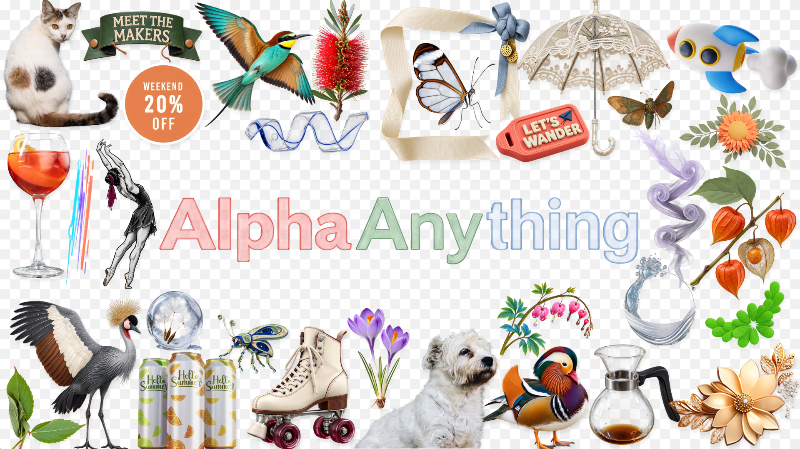
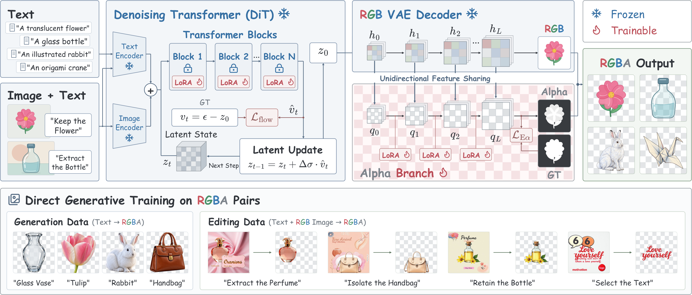
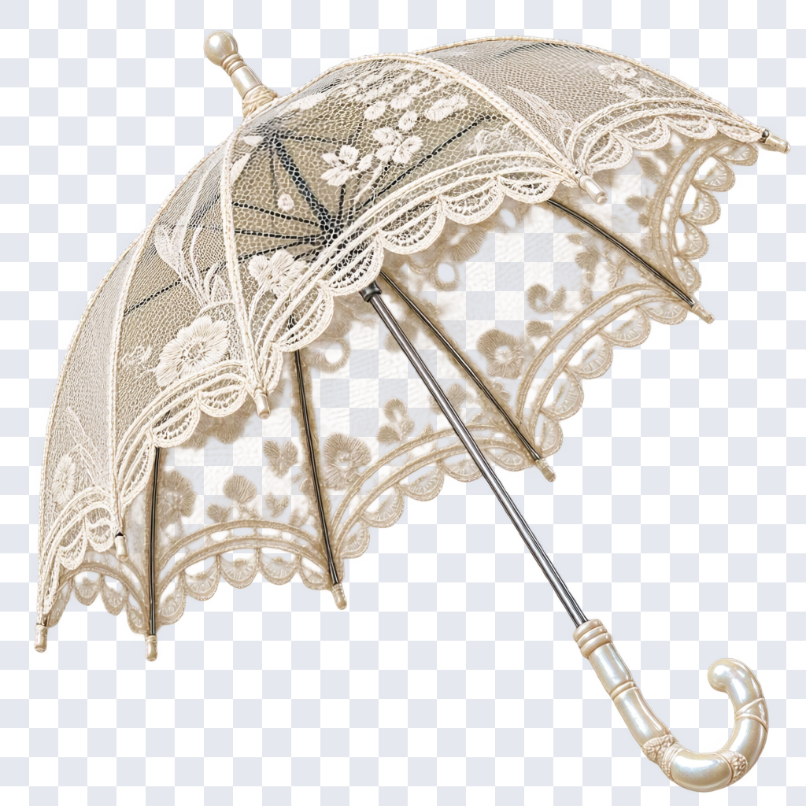
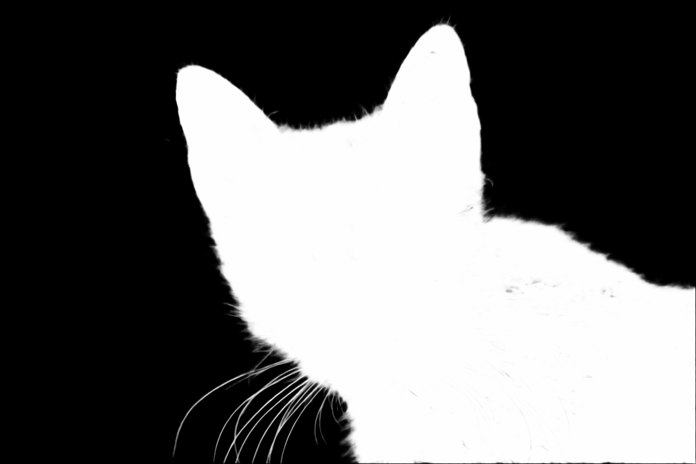
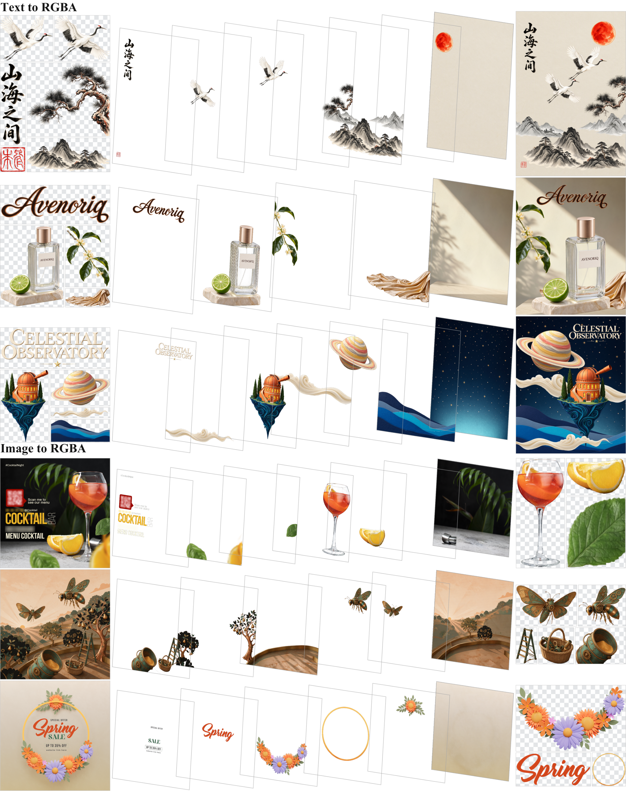

<div align="center">


# Extending Pretrained RGB Generators to RGBA

<p>
  <a href="mailto:wqj24@mails.tsinghua.edu.cn">Qijie Wang</a><sup>1,2,*,‡</sup> &nbsp;
  Zhixin Xu<sup>2,*</sup> &nbsp;
  Zhe Li<sup>3,2,‡</sup> &nbsp;
  Haowei Zhu<sup>1</sup><br />
  Honghao Qiao<sup>2</sup> &nbsp;
  Bo Peng<sup>2</sup> &nbsp;
  Dawei Li<sup>2,†</sup> &nbsp;
  Bin Wang<sup>1,†</sup>
</p>

<p><sup>1</sup> Tsinghua University &nbsp; <sup>2</sup> ByteDance &nbsp; <sup>3</sup> Peking University<br />
<sub><sup>*</sup> Equal contribution &nbsp; <sup>†</sup> Corresponding authors<br />
<sup>‡</sup> Work done during an internship at ByteDance.</sub></p>

[](https://wluli.github.io/AlphaAnything/)
[](https://arxiv.org/abs/2610.32413)
[](https://huggingface.co/WLuLi/AlphaAnything)
[](https://huggingface.co/datasets/WLuLi/AlphaAnything_Data)

</div>

<p align="center">
  
  <br />
  <sub>All elements, including the title, are generated or extracted with AlphaAnything and manually arranged into the final composition.</sub>
</p>

---

## 📅 Timeline

- **2026-11-22** — Code, Training Data, and Checkpoint release ([Checkpoints](https://huggingface.co/WLuLi/AlphaAnything) · [Training Data](https://huggingface.co/datasets/WLuLi/AlphaAnything_Data)).
- **2026-10-26** — arXiv paper and Project Page release.

## 📦 Supported Models

| Base Model | Task | Inference | Training | Adapter Weights |
| :--- | :---: | :---: | :---: | :---: |
| FLUX.2 Klein 9B ([Base](https://huggingface.co/black-forest-labs/FLUX.2-klein-base-9B) / [4-step](https://huggingface.co/black-forest-labs/FLUX.2-klein-9B)) | Text → RGBA | ✅ | ✅ (Base) | [](https://huggingface.co/WLuLi/AlphaAnything/tree/main/flux2_klein_base_9b_t2rgba) |
| FLUX.2 Klein 9B ([Base](https://huggingface.co/black-forest-labs/FLUX.2-klein-base-9B) / [4-step](https://huggingface.co/black-forest-labs/FLUX.2-klein-9B)) | Image → RGBA | ✅ | ✅ (Base) | [](https://huggingface.co/WLuLi/AlphaAnything/tree/main/flux2_klein_base_9b_i2rgba) |
| [Qwen-Image-2512](https://huggingface.co/Qwen/Qwen-Image-2512) | Text → RGBA | ✅ | — | [](https://huggingface.co/WLuLi/AlphaAnything/tree/main/qwen_image_2512_t2rgba) |
| [Qwen-Image-Edit-2511](https://huggingface.co/Qwen/Qwen-Image-Edit-2511) | Image → RGBA | ✅ | — | [](https://huggingface.co/WLuLi/AlphaAnything/tree/main/qwen_image_edit_2511_i2rgba) |

> [!NOTE]
> - Each adapter bundle packages only the transformer LoRA and alpha decoder branch; upstream RGB backbones are loaded automatically via Diffusers and remain subject to their respective licenses (see [NOTICE](NOTICE)).
> - Both FLUX.2 Klein adapters trained on `FLUX.2-klein-base-9B` can also be loaded directly onto the 4-step distilled `FLUX.2-klein-9B` via `--base-model`. Because they were trained on the Base model, 4-step inference works well in most cases but may occasionally be less reliable than `FLUX.2-klein-base-9B`.
> - The default `main` Image-to-RGBA adapters support both foreground and background-layer extraction (retrained under the same recipe by compositing `PrismLayersPro` foreground layers onto clean generated backgrounds). To strictly reproduce the foreground-only results reported in the paper, download the original weights via `hf download WLuLi/AlphaAnything --revision paper --local-dir alphaanything/checkpoints`.

## 🛠️ Installation

```bash
git clone https://github.com/WLuLi/AlphaAnything.git
cd AlphaAnything
pip install -r requirements.txt
```

Download the pretrained adapters into `alphaanything/checkpoints/`:

```bash
hf download WLuLi/AlphaAnything --local-dir alphaanything/checkpoints
```

## 🚀 Inference

Each run writes `sample.png` (RGBA), previews under `previews/`, and `metadata.json`. For Image-to-RGBA, describe the target object with `--description` (automatically wrapped into our extraction instruction), or pass a full custom instruction directly with `--prompt`. Pass `--disable-alpha` to turn off the LoRA and alpha branch and run native base-model RGB generation.

```bash
# Text to RGBA (FLUX.2 Klein Base 9B)
python scripts/flux2_klein/infer_t2rgba.py \
  --checkpoint alphaanything/checkpoints/flux2_klein_base_9b_t2rgba \
  --prompt "A delicate glass butterfly with translucent wings, isolated on a transparent background." \
  --output-dir outputs/flux2_klein_base_t2rgba \
  --num-inference-steps 50 --guidance-scale 4.0 --seed 42

# Image to RGBA (FLUX.2 Klein Base 9B)
python scripts/flux2_klein/infer_i2rgba.py \
  --checkpoint alphaanything/checkpoints/flux2_klein_base_9b_i2rgba \
  --image assets/poster.png \
  --description "The potted monstera on the left, including its three green leaves with broad openings, their stems, and the speckled cream ceramic pot." \
  --output-dir outputs/flux2_klein_base_i2rgba \
  --num-inference-steps 50 --guidance-scale 4.0 --seed 42
```

<details>
<summary><b>More backbones (FLUX.2 Klein 9B 4-step &amp; Qwen-Image / Qwen-Image-Edit)</b></summary>

```bash
# Text to RGBA — FLUX.2 Klein 9B (4-step)
python scripts/flux2_klein/infer_t2rgba.py \
  --checkpoint alphaanything/checkpoints/flux2_klein_base_9b_t2rgba \
  --base-model black-forest-labs/FLUX.2-klein-9B \
  --prompt "An ivory vintage lace parasol with intricate openwork embroidery and a slender wooden handle, isolated on a transparent background." \
  --output-dir outputs/flux2_klein_4step_t2rgba \
  --num-inference-steps 4 --guidance-scale 1.0 --seed 42

# Image to RGBA — FLUX.2 Klein 9B (4-step)
python scripts/flux2_klein/infer_i2rgba.py \
  --checkpoint alphaanything/checkpoints/flux2_klein_base_9b_i2rgba \
  --base-model black-forest-labs/FLUX.2-klein-9B \
  --image assets/poster.png \
  --prompt 'Give me only the smaller line "Everyday rituals, beautifully made." on a transparent background.' \
  --output-dir outputs/flux2_klein_4step_i2rgba \
  --num-inference-steps 4 --guidance-scale 1.0 --seed 42

# Text to RGBA — Qwen-Image-2512
python scripts/qwen_image/infer_t2rgba.py \
  --checkpoint alphaanything/checkpoints/qwen_image_2512_t2rgba \
  --prompt "A delicate translucent glass bird with fine crystal feathers and soft blue reflections, isolated on a transparent background." \
  --output-dir outputs/qwen_image_t2rgba \
  --num-inference-steps 50 --guidance-scale 4.0 --seed 42

# Image to RGBA — Qwen-Image-Edit-2511
python scripts/qwen_image_edit/infer_i2rgba.py \
  --checkpoint alphaanything/checkpoints/qwen_image_edit_2511_i2rgba \
  --image assets/poster.png \
  --description "The clear wine glass on the right, including its translucent bowl filled with deep red wine, slender glass stem, and round base." \
  --output-dir outputs/qwen_image_edit_i2rgba \
  --num-inference-steps 50 --guidance-scale 4.0 --seed 42
```

</details>

<details>
<summary><b>Python API &amp; Persistent HTTP Server (runtime RGB/RGBA &amp; multi-adapter switching)</b></summary>

Because the transformer LoRA is kept unmerged and the alpha branch is a one-way sidecar, a single loaded base model can switch between **native RGB** and **RGBA** (or across multiple adapters sharing the same backbone, such as FLUX.2 Klein T2RGBA and I2RGBA) with zero weight reload or precision drift:

```python
from alphaanything import AlphaAnythingPipeline

pipe = AlphaAnythingPipeline.from_pretrained(
    "alphaanything/checkpoints/flux2_klein_base_9b_t2rgba",
    adapter_name="t2rgba",
    device="cuda",
)
# Optionally mount a second adapter on the same base model
pipe.load_adapter("alphaanything/checkpoints/flux2_klein_base_9b_i2rgba", name="i2rgba")

# RGBA generation (LoRA + alpha branch ON)
rgba = pipe(prompt="A delicate glass butterfly with translucent wings.", adapter="t2rgba", enable_alpha=True, seed=42)
rgba.save("butterfly_rgba.png")

# Native base-model RGB generation (LoRA + alpha branch OFF)
rgb = pipe(prompt="A delicate glass butterfly resting on a wooden desk.", adapter="t2rgba", enable_alpha=False, seed=42)
rgb.save("butterfly_rgb.png")

# Image-to-RGBA on the same resident base model
extracted = pipe(
    image="assets/poster.png",
    description="The potted monstera on the left.",
    adapter="i2rgba",
    enable_alpha=True,
    seed=42,
)
extracted.save("monstera_rgba.png")
```

To keep one model resident on GPU and serve HTTP requests (optional dependencies: `pip install fastapi uvicorn python-multipart`):

```bash
python scripts/serve.py \
  --checkpoint t2rgba=alphaanything/checkpoints/flux2_klein_base_9b_t2rgba \
               i2rgba=alphaanything/checkpoints/flux2_klein_base_9b_i2rgba \
  --port 8000

# Text-to-RGBA (enable_alpha=true) or native RGB (enable_alpha=false)
curl -X POST http://localhost:8000/generate \
  -F "adapter=t2rgba" -F "enable_alpha=true" -F "seed=42" \
  -F "prompt=A delicate glass butterfly with translucent wings." \
  --output butterfly_rgba.png

# Image-to-RGBA (foreground or background extraction)
curl -X POST http://localhost:8000/generate \
  -F "adapter=i2rgba" -F "enable_alpha=true" -F "seed=42" \
  -F "image=@assets/poster.png" \
  -F "description=The potted monstera on the left." \
  --output monstera_rgba.png
```

</details>

## 📚 Data Preparation

Download and prepare our training datasets ([`WLuLi/AlphaAnything_Data`](https://huggingface.co/datasets/WLuLi/AlphaAnything_Data) for Text-to-RGBA and `PrismLayersPro` annotations for Image-to-RGBA) following the step-by-step instructions in **[docs/data.md](docs/data.md)**.

## 🏋️ Training

Training is supported for **FLUX.2 Klein Base 9B** on both Text-to-RGBA and Image-to-RGBA via Accelerate DDP.

- **Default setup**: 8 GPUs, effective batch size `16` (`per_device_batch_size=1`, `grad_accum=2`), `20,000` steps, `bf16`, LoRA `r=64 / alpha=128`, AdamW `1e-4` with cosine schedule.
- **Configs**: [`configs/flux2_klein/train_base_9b_t2rgba.yaml`](configs/flux2_klein/train_base_9b_t2rgba.yaml) · [`configs/flux2_klein/train_base_9b_i2rgba.yaml`](configs/flux2_klein/train_base_9b_i2rgba.yaml)

After preparing the datasets, edit paths or hyperparameters in the launch scripts as needed and run:

```bash
# Text-to-RGBA
bash scripts/flux2_klein/run_train_t2rgba.sh

# Image-to-RGBA
bash scripts/flux2_klein/run_train_i2rgba.sh
```

> [!TIP]
> Saved checkpoints (`outputs/train/.../checkpoint-N`) can be passed directly to `--checkpoint` for inference, or resumed by setting `--resume_from` in the launch script or YAML.

---

## 🧩 Method

<p align="center">
  
</p>

## 🖼️ Qualitative Examples

### Text to transparent assets

<table>
  <tr>
    <td align="center" width="25%"><br /><sub>Glasswing butterfly</sub></td>
    <td align="center" width="25%"><br /><sub>Lace parasol</sub></td>
    <td align="center" width="25%"><br /><sub>Glass bird</sub></td>
    <td align="center" width="25%"><br /><sub>Fine feathers</sub></td>
  </tr>
</table>

### Images to editable layers

| Input RGB | Extracted RGBA | Predicted alpha |
| :---: | :---: | :---: |
|  |  |  |
|  |  |  |

### Compose and decompose

<p align="center">
  
</p>

## 📝 Citation

If you find AlphaAnything useful in your research, please consider citing:

```bibtex
@misc{wang2026alphaanything,
  title  = {AlphaAnything: Extending Pretrained RGB Generators to RGBA},
  author = {Qijie Wang and Zhixin Xu and Zhe Li and Haowei Zhu and
            Honghao Qiao and Bo Peng and Dawei Li and Bin Wang},
  year   = {2026},
  eprint = {2610.32413},
  archivePrefix = {arXiv},
  primaryClass = {cs.CV},
  url    = {https://arxiv.org/abs/2610.32413}
}
```

Contact: [Qijie Wang](mailto:wqj24@mails.tsinghua.edu.cn).

## Acknowledgments

We thank the authors of the pretrained RGB models and open-source libraries used in this work.
