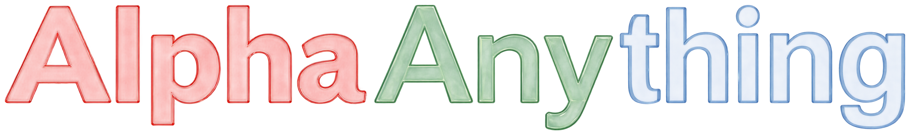
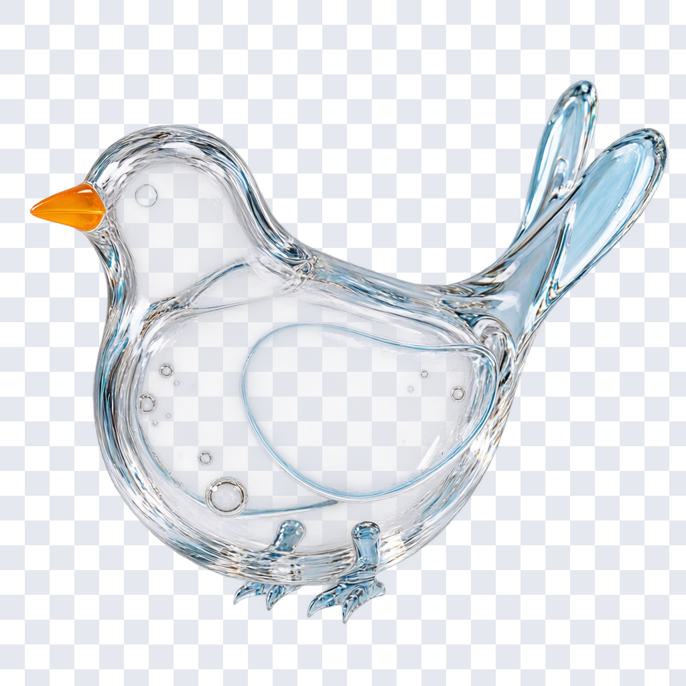
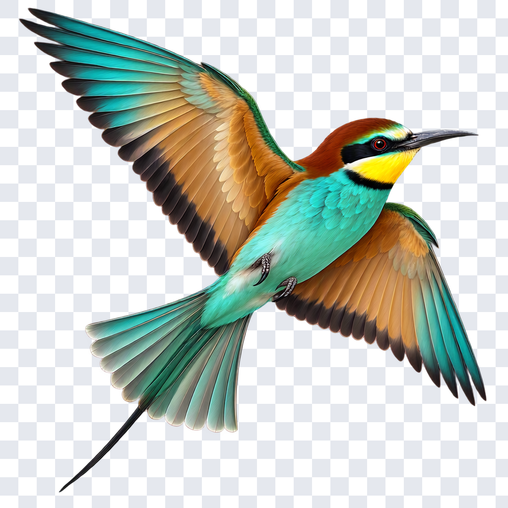
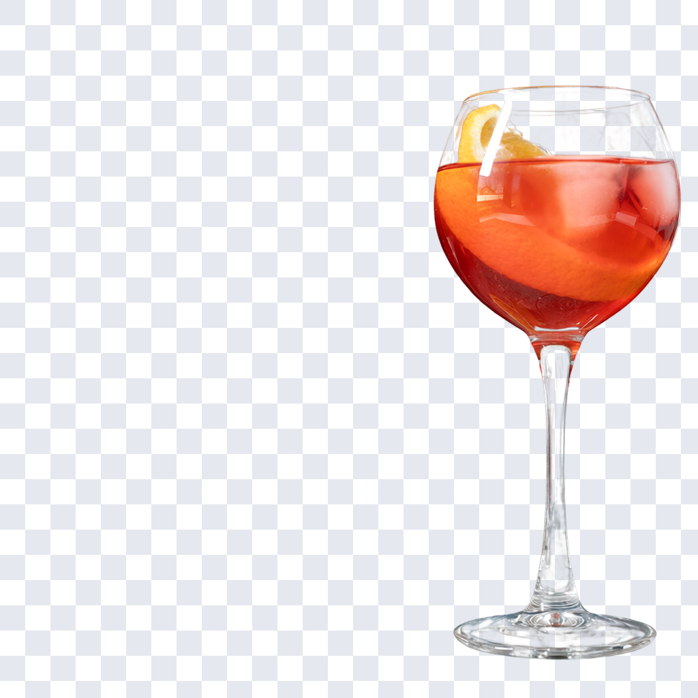
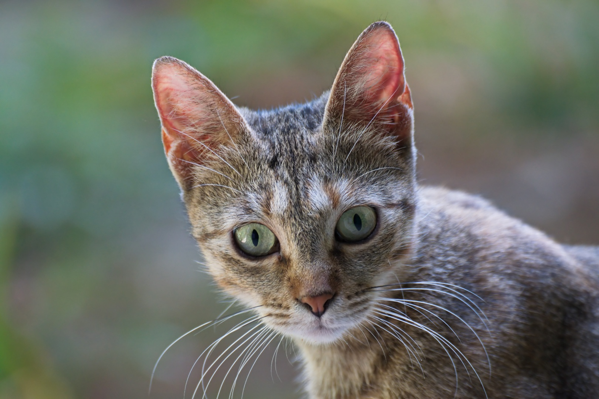
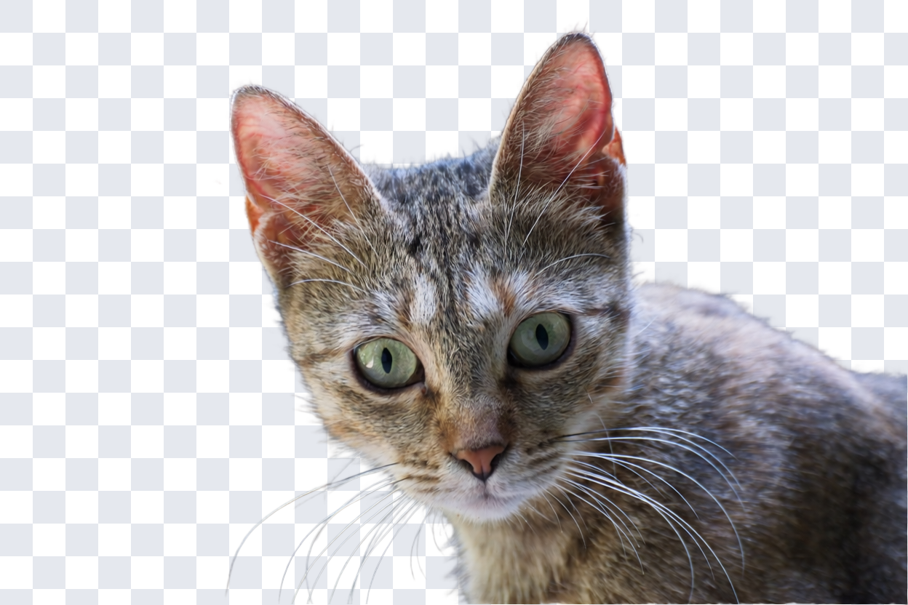

<div align="center">



# Extending Pretrained RGB Generators to RGBA

<p>
  <a href="mailto:wqj24@mails.tsinghua.edu.cn">Qijie Wang</a><sup>1,2,*,‡</sup> &nbsp;
  Zhixin Xu<sup>2,*</sup> &nbsp;
  Zhe Li<sup>3,2</sup> &nbsp;
  Haowei Zhu<sup>1</sup><br />
  Honghao Qiao<sup>2</sup> &nbsp;
  Bo Peng<sup>2</sup> &nbsp;
  Dawei Li<sup>2,†</sup> &nbsp;
  Bin Wang<sup>1,†</sup>
</p>

<p><sup>1</sup> Tsinghua University &nbsp; <sup>2</sup> ByteDance &nbsp; <sup>3</sup> Peking University<br />
<sub><sup>*</sup> Equal contribution &nbsp; <sup>†</sup> Corresponding authors<br />
<sup>‡</sup> Work done during an internship at ByteDance.</sub></p>

[](https://wluli.github.io/AlphaAnything/)
[](https://arxiv.org/abs/2610.32413)
[](#timeline)

</div>

<p align="center">
  
  <br />
  <sub>All elements, including the title, are generated or extracted with AlphaAnything and manually arranged into the final composition.</sub>
</p>

## Timeline

- **2026-10-26** — arXiv and Project Page release.
- **Code and Checkpoint: Coming Soon.**

## ✨ Overview

**AlphaAnything** extends pretrained RGB generators to RGBA **in their original latent space**, without a separate RGBA reconstruction pretraining stage. A lightweight alpha branch learns opacity alongside appearance, turning generated or extracted content into transparent layers.

- **Native RGBA generation.** Generate an individual transparent asset from a text prompt.
- **Prompt-guided extraction.** Extract a requested object or graphic element from an image, including fine details and partial transparency.
- **Preserved RGB decoding.** Freeze the pretrained RGB VAE and share features only from RGB to alpha; the RGB decoding function remains identical for any fixed latent.
- **Endpoint-Aware Alpha Loss.** Supervise exact transparent and opaque endpoints, continuous partial transparency, and localized alpha errors.

## 🧩 Method

<p align="center">
  
</p>

1. **Keep the original RGB latent space.** The pretrained RGB encoder and decoder remain frozen.
2. **Learn appearance and opacity jointly.** Transformer LoRA and the alpha branch are optimized with flow matching and alpha supervision. RGB-to-alpha feature sharing lets alpha supervision shape the generative latent.
3. **Supervise compositing behavior.** EA Loss derives opacity supervision from the complementary foreground and background weights used in alpha compositing.

The fixed-latent preservation property concerns the **RGB decoder**; adapting the generative transformer can change the latents it produces.

## 🖼️ Qualitative examples

### Text to transparent assets

<table>
  <tr>
    <td align="center" width="25%"><br /><sub>Glasswing butterfly</sub></td>
    <td align="center" width="25%"><br /><sub>Lace parasol</sub></td>
    <td align="center" width="25%"><br /><sub>Glass bird</sub></td>
    <td align="center" width="25%"><br /><sub>Fine feathers</sub></td>
  </tr>
</table>

### Images to editable layers

| Input RGB | Extracted RGBA | Predicted alpha |
| :---: | :---: | :---: |
|  |  |  |
|  |  |  |

### Compose and decompose

<p align="center">
  
</p>

## Citation

Please cite the paper as:

```bibtex
@misc{wang2026alphaanything,
  title  = {AlphaAnything: Extending Pretrained RGB Generators to RGBA},
  author = {Qijie Wang and Zhixin Xu and Zhe Li and Haowei Zhu and
            Honghao Qiao and Bo Peng and Dawei Li and Bin Wang},
  year   = {2026},
  eprint = {2610.32413},
  archivePrefix = {arXiv},
  primaryClass = {cs.CV},
  url    = {https://arxiv.org/abs/2610.32413}
}
```

Contact: [Qijie Wang](mailto:wqj24@mails.tsinghua.edu.cn).

## Acknowledgments

We thank the authors of the pretrained RGB models used in this work.
